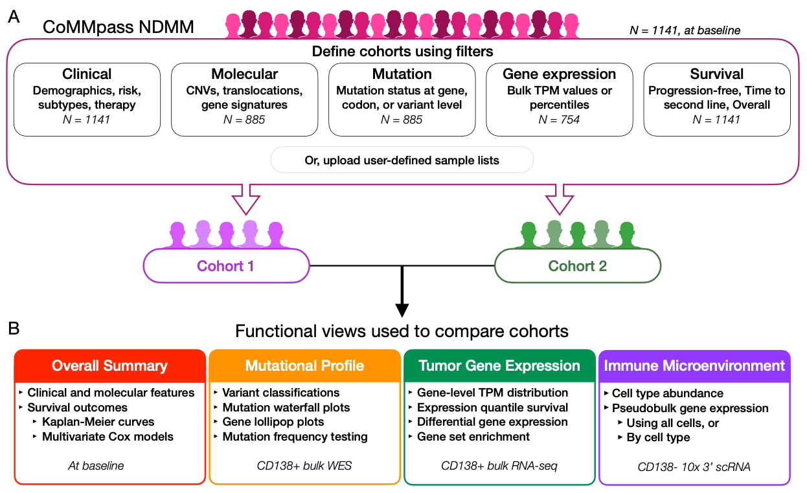

# MMRF CoMMpass Explorer

The Multiple Myeloma Research Foundation's CoMMpass study followed 1143 patients from 2011 to 2023 while measuring a variety of clinical and genomic variables (NCT01454297).
MMRF's CoMMpass Explorer is an R shiny app that allows users to define patient cohorts and interactively compare their clinical and genomic data.

CoMMpass data is available for download at [virtuallab.themmrf.org](virtuallab.themmrf.org).
Learn more about myeloma and the MMRF at [themmrf.org](themmrf.org).

## Getting started

Academic and non-profit users may apply for a free account by visiting [commpassexplorer.themmrf.org](commpassexplorer.themmrf.org).
Once you have an account, you may log in to the platform from that same page.

**Figure 1: CoMMpass Explorer app overview. A.** Users define two cohorts for comparison using filters based on clinical, molecular, mutation, gene expression, and survival data. Users may also upload their own sample lists to define cohorts. **B.** CoMMpass Explorer presents four functional views, including an Overall Summary, Mutational Profile, Tumor Gene Expression, and Immune Microenvironment. Each view includes several tools and visualizations for cohort comparison.

## Need help?

If you need help or have a suggestion, please create an issue on this page or email us at commpassexplorer@themmrf.org.

## Cite CoMMPass Explorer

If you use CoMMpass Explorer in your work, please cite: *publication information pending*
